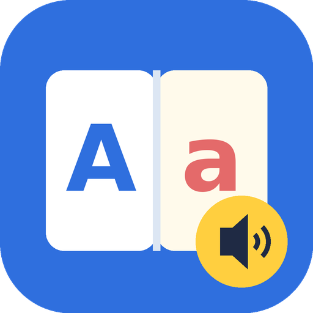

# 📖 English for Boudy & Anoos



Vocabulary helper for **El-Moasser English · First Term 2027**, two books in one app:

- 🌱 **Primary 3** (457 words, 6 units + starter)
- 🚀 **Primary 4** (666 words, 6 units + starter + review)

On launch the kid picks **Primary 3** or **Primary 4**, then types a page number and sees that page's words in book order, each with an Arabic meaning, one simple example with its Arabic translation, and a 🔊 button that speaks it with a calm, slow American man's voice.

## 📱 Install on the tablet

1. Open **Releases** → latest → download `kalimat.apk` on the tablet.
2. Tap it → allow "Install unknown apps" for the browser once → Install.
3. For the voice: Settings → Text-to-speech → Google → install **English (United States)**. The app always picks a male US voice (Google's `iom`, then `iol`, then `tpd`).

## 🧒 Using it

- 🎓 **First screen**: pick Primary 3 or Primary 4 (🔁 to switch later)
- 🏠 **Home**: pick a unit → all its words, page by page, with pictures from the book where the book has them
- 🔢 **Page pad**: type the printed page number → that page's words in book order
- 🔊 tap the speaker or the picture to hear the word; 🗣️ to hear the example
- 📝 **Tests**: every lesson has a test (12 questions) and every unit has a full test (20 questions): listen, picture, Arabic ↔ English, complete the sentence. Best score is saved with ⭐, and "🎯 retry mistakes" repeats only the wrong words
- ⚙️ **Settings**: speed, pitch, which male voice, show/hide pictures · Arabic · examples, and **🔄 check for updates / install the new version**

## 🔄 How updates work

| You change | You push to `main` | The app |
|---|---|---|
| `web/data/pages.js` / `pages3.js` (words) or `web/index.html` (look) | ✅ | Downloads it on next launch, no reinstall |
| anything in `android/` | ✅ | GitHub Actions builds a new APK release; the app shows "🆕 new version" and installs it from ⚙️ Settings |

New APKs are always signed with the same key (`android/app/kalimat.jks`), so they install over the old one and keep the kid's progress.

## ✏️ Adding or fixing words

Edit `web/data/pages3.js` (Primary 3) or `web/data/pages.js` (Primary 4). Each page is the **printed** page number of that grade's book:

```js
"23": [
  { "w": "taste", "ar": "حاسة التذوق", "ex": "We taste with our tongue." },
  ...
]
```

Pages that have no entry show "no new words" and point to the nearest page that has some.

## 🗂️ Layout

```
web/                 the app itself (also runs in any browser)
  index.html
  data/pages3.js     Primary 3 vocabulary, by page (+ units)
  data/pages.js      Primary 4 vocabulary, by page (+ units)
  img/               word pictures cropped from the books (img/g3/ = Primary 3)
  manifest.json      files the app downloads on update
android/             WebView wrapper + native American-English text-to-speech
.github/workflows/   builds and releases the APK
```
